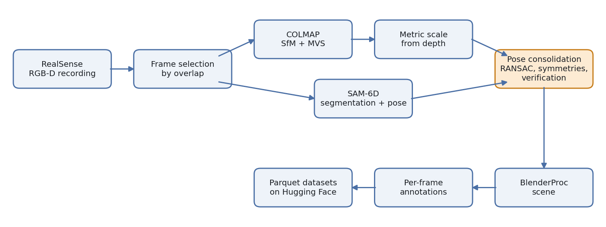
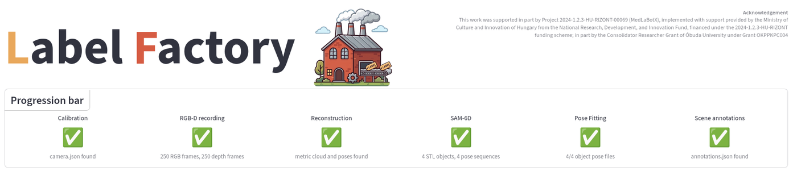

# Label Factory: Real-World Dataset Generation for Robotic Perception

[](https://github.com/ABC-iRobotics/Label_Factory/releases)
[](LICENSE)
[](environment.yml)
[](docker/Dockerfile)
[](docs/INSTALL_DOCKER.md)
[](https://abc-irobotics.github.io/Label_Factory/)
[](https://huggingface.co/ABC-iRobotics)


Label Factory turns a short, hand-held RGB-D recording of a static scene and the
CAD models of the objects in it into training data for **depth estimation**,
**instance segmentation** and **6DoF object pose estimation**, without
object-specific network training and without frame-by-frame manual annotation.

| | |
|---|---|
| **Project page** | <https://abc-irobotics.github.io/Label_Factory/> |
| **Hugging Face datasets** | [Hand tools](https://huggingface.co/datasets/ABC-iRobotics/Hand_Tools) · [Labware items](https://huggingface.co/datasets/ABC-iRobotics/LabWare_Items) · [organization](https://huggingface.co/ABC-iRobotics) |
| **Documentation** | [`docs/`](docs/README.md): installation, user interface guide, command-line usage, dataset format |
| **Paper** | *In preparation.* |

## Table of contents

- [Overview](#overview)
  - [How it works](#how-it-works)
  - [Key results](#key-results)
  - [Published datasets](#published-datasets)
- [Installation](#installation)
- [Usage](#usage)
- [Reproducing the paper results](#reproducing-the-paper-results)
- [Limitations](#limitations)
- [Repository layout](#repository-layout)
- [Citation](#citation)
- [License](#license)
- [Acknowledgement](#acknowledgement)

## Overview

Collecting accurately annotated real-world data is a bottleneck for learning-based
robotic perception. Manual annotation is slow and inconsistent, and purely
synthetic data differs from what real sensors observe. Label Factory keeps the
real RGB-D observations and obtains the annotations from geometry: the objects
are located once in a metric reconstruction of the scene, and the result is then
projected into every recorded frame.

The framework needs

- an RGB-D recording of a **static** scene, moved around the objects,
- a calibrated RGB-D camera: the calibration is part of the framework and is done once per camera and resolution, see [Usage](#usage),
- a **metric CAD model** (STL, optionally a textured OBJ) of every object.

It produces, for every registered frame, instance masks, bounding boxes,
6DoF object poses, aligned depth and the camera trajectory, organized as
task-specific datasets that can be published to Hugging Face.

### How it works

<picture>
  <source media="(prefers-color-scheme: dark)" srcset="docs/images/workflow_dark.png">
  
</picture>

1. **Frame selection.** Two subsets of the recorded frames are selected by visual
   overlap: a sparser one for the reconstruction and a denser one for pose
   estimation. All frames are kept for the final dataset.
2. **Metric scene reconstruction.** COLMAP recovers the camera trajectory and a
   dense point cloud; the depth measurements of the sensor fix the metric scale.
3. **Zero-shot pose estimation.** SAM-6D estimates frame-level poses of the known
   objects from their CAD models. Templates are rendered with BlenderProc, with
   the textured model if one is available.
4. **Multi-frame consolidation.** The poses are transformed into the common
   metric frame and merged by deterministic RANSAC with symmetry-aware
   orientation consensus. CAD symmetries are detected automatically, several
   instances of an object are supported, and rarely detected objects are kept as
   flagged low-support estimates. An optional check compares the CAD silhouette
   with the segmentation masks.
5. **Annotation rendering.** The consolidated scene is rendered from every
   registered camera, which also annotates frames that SAM-6D never processed.
6. **Dataset generation.** The annotations are written as per-frame JSON and
   mask images and as Parquet tables for the three tasks.

### Key results

Annotation accuracy on the 12 test sequences of the BOP19 YCB-Video benchmark
(4,123 target instances, 21 object categories, pooled over all targets). The
CAD models are given; no ground-truth poses are used.

| Metric | Label Factory |
|---|---|
| ADD-S AUC | 97.0 |
| ADD(-S) AUC | 90.9 |
| BOP AR (VSD, MSSD, MSPD) | 88.5 |
| Mask IoU | 86.7 % |
| Median translational error | 4.1 mm |

Multi-frame consolidation improves the single-frame SAM-6D baseline (same
configuration, same 970 targets) from 77.7 to 96.8 ADD-S AUC. The remaining
ADD(-S) gap to trained single-view methods is concentrated in the
nearly rotationally symmetric master chef can and tuna fish can, whose
orientation is determined only by their printed label.

Processing time on a laptop workstation (NVIDIA RTX 2000 Ada, 8 GB VRAM;
Intel Core i5-13600HX; 32 GB RAM), measured over 20 recorded scenes of 250 RGB-D
frames each: **30.1 ± 3.6 min per scene**; the SAM-6D stage takes 59 % of it.

**Comparison with multi-view methods.** Label Factory consolidates the pose
estimates of many frames of a static scene, so the relevant published references
are multi-view methods on the same benchmark. They work on RGB images (AlignPose
and CosyPose on top of single-view pose candidates), whereas Label Factory uses
RGB-D, the CAD models and no training on the benchmark. The numbers of views and
the evaluation protocols differ, so the table shows the accuracy level rather
than a like-for-like ranking. AlignPose reports the BOP average recall (AR), the
same metric as in the table above.

| Method | Input | BOP AR | ADD-S AUC | Source |
|---|---|---|---|---|
| **Label Factory (ours)** | RGB-D sequence, all frames | **88.5** | **97.0** | this work |
| AlignPose (multi-view, on FoundPose candidates) | RGB, multi-view | 83.9 | not reported | [arXiv 2512.20538](https://arxiv.org/abs/2512.20538) |
| CosyPose multi-view (on FoundPose candidates) | RGB, multi-view | 79.2 | not reported | [arXiv 2512.20538](https://arxiv.org/abs/2512.20538) |
| CosyPose (5 views) | RGB, multi-view | not reported | 93.4 | [arXiv 2008.08465](https://arxiv.org/abs/2008.08465) |

The AlignPose paper also applies the multi-view step to other single-view
candidates (GigaPose, MegaPose, Co-op) with AR between 80.0 and 83.8.

The tables and per-object results are in [`evaluation/`](evaluation).

### Published datasets

The datasets recorded with the framework (ten scenes each) are published on
Hugging Face:

- Hand tools: <https://huggingface.co/datasets/ABC-iRobotics/Hand_Tools>
- Labware items: <https://huggingface.co/datasets/ABC-iRobotics/LabWare_Items>

Each dataset provides the configurations `depth_estimation`,
`instance_segmentation`, `object_pose_estimation` and `object_pose_models`
(CAD meshes). RGB, depth and masks are embedded as images, so they render in the
Hub dataset viewer, and the train/validation/test split is deterministic.

```python
from datasets import load_dataset

poses = load_dataset("ABC-iRobotics/Hand_Tools", "object_pose_estimation")
sample = poses["test"][0]
rgb = sample["image"].convert("RGB")
```

The dataset cards and [`docs/DATASETS.md`](docs/DATASETS.md) contain complete
loading examples for all four configurations.

## Installation

| | |
|---|---|
| Operating system | Linux |
| GPU | NVIDIA, 8 GB VRAM or more; driver compatible with CUDA 11.8 (dense reconstruction has no CPU fallback) |
| Camera (only for recording) | any camera supported by the RealSense SDK (`pyrealsense2`), USB 3. The recordings of the paper were made with an Intel RealSense D455. The pipeline also runs on existing RGB-D sequences |
| Disk | about 25 GB for the Docker image, about 5 GB for the model weights, and several GB per recorded scene |

Choose one of the two installation methods:

- **[Docker-based installation](docs/INSTALL_DOCKER.md) (recommended).** The image
  contains both Python environments, the CUDA build tools, Blender and
  BlenderProc. In short:

  ```bash
  git clone https://github.com/ABC-iRobotics/Label_Factory.git && cd Label_Factory
  mkdir -p data calibration/cameras checkpoints/ism checkpoints/pem   # then add the SAM-6D checkpoints
  docker compose build
  xhost +local:docker && docker compose up
  ```

- **[Native installation](docs/INSTALL_NATIVE.md).** Two Conda environments
  (`label-factory`, `sam6d`), CUDA 11.8, Blender 3.3.1 and the PointNet2
  extension are set up on the host.

In both cases the SAM-6D model weights are downloaded separately from the upstream
[SAM-6D](https://github.com/JiehongLin/SAM-6D) project; they are not part of this
repository.

## Usage

The framework is operated from the graphical user interface or from the command
line. Open <http://localhost:8501> after starting the application. The
progression bar at the top shows whether the expected outputs of each stage exist
(`✅`), whether the prerequisites are ready (`▶️`) or whether inputs are missing
(`⛔`); the tabs below it lead through the workflow:

1. **Setup**: dataset selection, environment check, STL model upload,
2. **Capture**: ChArUco calibration (once per camera) and RGB-D recording,
3. **Reconstruction**: SfM, dense reconstruction and metric scaling,
4. **Instance segmentation & pose estimation**: SAM-6D,
5. **Pose fitting**: multi-frame pose consolidation,
6. **Scene & annotation**: masks, overlays and the review video,
7. **Review & publish**: inspection, dataset splitting and reviewed upload to
   Hugging Face.

<picture>
  <source media="(prefers-color-scheme: dark)" srcset="docs/images/ui_overview_dark.png">
  
</picture>

The only inputs are the **CAD models** of the objects and an **RGB-D recording**
of the scene. The camera calibration is built into the framework: it is created
once per camera and resolution, and an existing calibration can be reused.

- **[User interface guide](docs/UI_GUIDE.md):** every tab step by step, with
  screenshots and all settings.
- **[Command-line guide](docs/USAGE.md):** every stage as a script, the input and
  output layout, troubleshooting.
- **[Datasets](docs/DATASETS.md):** format and loading examples of the published
  datasets.

## Reproducing the paper results

The YCB-Video BOP19 evaluation and the runtime measurement are described in
[`docs/USAGE.md`](docs/USAGE.md#7-evaluate-on-ycb-video-bop19). The result
tables of the paper are stored in [`evaluation/ycbv/`](evaluation/ycbv) and
[`evaluation/runtime/`](evaluation/runtime).

## Limitations

- The scene must be **static** during the recording, and every object needs a
  CAD model with the correct metric scale.
- The accuracy depends on the RGB-D alignment, the camera intrinsics and the
  viewpoint coverage. Errors of the reconstruction propagate into the object
  poses.
- Objects that are almost rotationally symmetric and differ only by their texture
  (for example the master chef can and the tuna fish can of YCB-Video) have a
  lower orientation accuracy.
- Objects that SAM-6D detects in too few frames are kept only as flagged
  low-support estimates, and objects that are never detected are not annotated.
- Several identical objects need distinct positions; copies that are closer than
  the translation threshold can merge into one instance.
- The annotation accuracy is evaluated on YCB-Video. For the recorded hand-tool and
  labware datasets there is no independent ground truth, so only their run time
  is reported.

## Repository layout

```text
.
├── scripts/            pipeline stages, evaluation and utilities
│   └── configs/        project configuration (default.yaml)
├── ui/                 Streamlit user interface
├── docker/             Dockerfile, entrypoint, SAM-6D requirements, hardware profiles
├── external/SAM-6D/    SAM-6D source with the patches used by the pipeline
├── evaluation/         YCB-Video and runtime result tables
├── docs/               documentation index, installation, user interface and usage guides, dataset format, project page
├── compose.yaml        Docker Compose service
├── environment.yml     conda environment of the reconstruction pipeline
└── LICENSE             MIT license
```

## Citation

The article describing Label Factory has not been published yet. The citation
will be added here after publication. Until then, please refer to this
repository.

## License

The Label Factory code is released under the [MIT License](LICENSE).

The repository uses the following third-party software, which keeps its own
license. Check the terms of each component, in particular for the model weights,
before redistribution or commercial use.

| Component | Use | License |
|---|---|---|
| [SAM-6D](https://github.com/JiehongLin/SAM-6D) (`external/SAM-6D`, with patches) | zero-shot segmentation and pose estimation | see the upstream repository and the notices in `external/SAM-6D/` |
| SAM-6D checkpoints, Segment Anything, DINOv2, FastSAM | model weights, not distributed here | license of each upstream project |
| [COLMAP](https://colmap.github.io/) / PyCOLMAP | SfM and MVS | BSD |
| [BlenderProc](https://github.com/DLR-RM/BlenderProc) and [Blender](https://www.blender.org/) 3.3.1 | template and annotation rendering | GPL-3.0 (downloaded in the Docker image, not redistributed here) |
| [bop_toolkit](https://github.com/thodan/bop_toolkit) | official BOP evaluation, cloned separately | MIT |
| [Open3D](https://www.open3d.org/), PyTorch, Streamlit, and other Python dependencies | see `environment.yml`, `ui/requirements.txt`, `docker/` | their respective licenses |

The YCB-Video and BOP data are subject to the terms of their authors. The
datasets published on Hugging Face state their license in their dataset cards.

## Acknowledgement

This work was supported in part by Project 2024-1.2.3-HU-RIZONT-00069
(MedLaBotX), implemented with support provided by the Ministry of Culture and
Innovation of Hungary from the National Research, Development, and Innovation
Fund, financed under the 2024-1.2.3-HU-RIZONT funding scheme; in part by the
Consolidator Researcher Grant of Óbuda University under Grant OKPPKPC004.

Label Factory was developed at the Antal Bejczy Center for Intelligent Robotics,
Óbuda University, Budapest. It builds on SAM-6D, COLMAP, BlenderProc, Segment
Anything, DINOv2, Open3D, the BOP benchmark and the YCB-Video dataset, and
follows the idea of the Blender Annotation Tool (BAT). We thank the authors of
these projects for making their work available.
