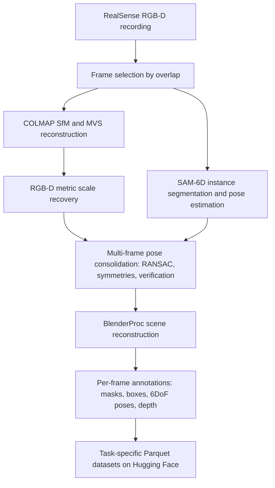

# Label Factory: Real-World Dataset Generation for Robotic Perception

[](https://github.com/ABC-iRobotics/Label_Factory/releases)
[](LICENSE)
[](environment.yml)
[](docker/Dockerfile)
[](docs/DOCKER.md)
[](https://abc-irobotics.github.io/Label_Factory/)
[](https://huggingface.co/KarolyArmin)


Label Factory turns a short, hand-held RGB-D recording of a static scene and the
CAD models of the objects in it into training data for **depth estimation**,
**instance segmentation** and **6DoF object pose estimation**, without
object-specific network training and without frame-by-frame manual annotation.

| | |
|---|---|
| **Project page** | <https://abc-irobotics.github.io/Label_Factory/> |
| **Hugging Face** | <https://huggingface.co/ABC-iRobotics>  
Hand tools dataset | https://huggingface.co/datasets/ABC-iRobotics/Hand_Tools 
Labware items dataset | https://huggingface.co/datasets/ABC-iRobotics/LabWare_Items |
| **User interface guide** | [`docs/UI_GUIDE.md`](docs/UI_GUIDE.md): step-by-step walkthrough with screenshots |
| **Paper** | *In progress.*|

## Table of contents

- [Overview](#overview)
  - [How it works](#how-it-works)
  - [Key results](#key-results)
  - [Published datasets](#published-datasets)
- [Installation](#installation)
  - [Requirements](#requirements)
  - [Install with Docker (recommended)](#install-with-docker-recommended)
  - [Native installation](#native-installation)
- [Usage](#usage)
  - [Quick start with the user interface](#quick-start-with-the-user-interface)
  - [Command-line workflow](#command-line-workflow)
  - [Input and output layout](#input-and-output-layout)
  - [Using the published datasets](#using-the-published-datasets)
  - [Reproducing the paper results](#reproducing-the-paper-results)
- [Repository layout](#repository-layout)
- [Citation](#citation)
- [License](#license)
- [Acknowledgement](#acknowledgement)

## Overview

Collecting accurately annotated real-world data is a bottleneck for learning-based
robotic perception. Manual annotation is slow and inconsistent, and purely
synthetic data differs from what real sensors observe. Label Factory keeps the
real RGB-D observations and obtains the annotations from geometry: the objects
are located once in a metric reconstruction of the scene, and the result is then
projected into every recorded frame.

The framework needs

- an RGB-D recording of a **static** scene, moved around the objects,
- a calibrated RGB-D camera: the calibration is part of the framework and is done once per camera and resolution, see [Usage](#quick-start-with-the-user-interface),
- a **metric CAD model** (STL, optionally a textured OBJ) of every object.

It produces, for every registered frame, instance masks, bounding boxes,
6DoF object poses, aligned depth and the camera trajectory, organized as
task-specific datasets that can be published to Hugging Face.

### How it works



1. **Frame selection.** Two subsets of the recorded frames are selected by visual
   overlap: a sparser one for the reconstruction and a denser one for pose
   estimation. All frames are kept for the final dataset.
2. **Metric scene reconstruction.** COLMAP recovers the camera trajectory and a
   dense point cloud; the depth measurements of the sensor fix the metric scale.
3. **Zero-shot pose estimation.** SAM-6D estimates frame-level poses of the known
   objects from their CAD models. Templates are rendered with BlenderProc, with
   the textured model if one is available.
4. **Multi-frame consolidation.** The poses are transformed into the common
   metric frame and merged by deterministic RANSAC with symmetry-aware
   orientation consensus. CAD symmetries are detected automatically, several
   instances of an object are supported, and rarely detected objects are kept as
   flagged low-support estimates. An optional check compares the CAD silhouette
   with the segmentation masks.
5. **Annotation rendering.** The consolidated scene is rendered from every
   registered camera, which also annotates frames that SAM-6D never processed.
6. **Dataset generation.** The annotations are written as per-frame JSON and
   mask images and as Parquet tables for the three tasks.

### Key results

Annotation accuracy on the 12 test sequences of the BOP19 YCB-Video benchmark
(4,123 target instances, 21 object categories, pooled over all targets). The
CAD models are given; no ground-truth poses are used.

| Metric | Label Factory |
|---|---|
| ADD-S AUC | 97.0 |
| ADD(-S) AUC | 90.9 |
| BOP AR (VSD, MSSD, MSPD) | 88.5 |
| Mask IoU | 86.7 % |
| Median translational error | 4.1 mm |

Multi-frame consolidation improves the single-frame SAM-6D baseline (same
configuration, same 970 targets) from 77.7 to 96.8 ADD-S AUC. The remaining
ADD(-S) gap to trained single-view methods is concentrated in the
nearly rotationally symmetric master chef can and tuna fish can, whose
orientation is determined only by their printed label.

Processing time on a laptop workstation (NVIDIA RTX 2000 Ada, 8 GB VRAM;
Intel Core i5-13600HX; 32 GB RAM), measured over 20 recorded scenes of 250 RGB-D
frames each: **30.1 ± 3.6 min per scene**; the SAM-6D stage takes 59 % of it.

The tables and per-object results are in [`evaluation/`](evaluation).

### Published datasets

The datasets recorded with the framework (hand tools and labware items, ten
scenes each) are published on Hugging Face:

- Hand tools: <https://huggingface.co/datasets/ABC-iRobotics/Hand_Tools>
- Labware: <https://huggingface.co/KarolyArmin> <!-- TODO: add the direct link of the labware dataset -->

Each dataset provides the configurations `depth_estimation`,
`instance_segmentation`, `object_pose_estimation` and `object_pose_models`,
see [Using the published datasets](#using-the-published-datasets).

## Installation

### Requirements

| | |
|---|---|
| Operating system | Linux |
| GPU | NVIDIA, 8 GB VRAM or more; driver compatible with CUDA 11.8 |
| Camera (for capture) | Intel RealSense D455, USB 3 (tested configuration) |
| Disk | Several GB for the Docker image, the model weights (about 5 GB) and each recorded scene |
| Docker (recommended) | Docker Engine with the Compose plugin and the NVIDIA Container Toolkit |

An 8 GB GPU is sufficient when the frames are subsampled by the overlap-based
frame selection. Recording is only needed for your own scenes; the pipeline also
runs on existing RGB-D sequences.

### Install with Docker (recommended)

Docker provides the Label Factory and SAM-6D environments, the CUDA build
tools, Blender, BlenderProc and the COLMAP bindings.

**1. Host prerequisites.** Install Docker, the NVIDIA driver and the
[NVIDIA Container Toolkit](https://docs.nvidia.com/datacenter/cloud-native/container-toolkit/latest/install-guide.html),
then verify GPU access:

```bash
sudo nvidia-ctk runtime configure --runtime=docker
sudo systemctl restart docker
docker run --rm --gpus all nvidia/cuda:11.8.0-base-ubuntu22.04 nvidia-smi
```

**2. Clone the repository.**

```bash
git clone https://github.com/ABC-iRobotics/Label_Factory.git
cd Label_Factory
```

**3. Add the SAM-6D checkpoints.** The model weights are not part of the
repository. Download them from the upstream
[SAM-6D](https://github.com/JiehongLin/SAM-6D) project, under its license, and
place them as follows:

```text
checkpoints/
├── ism/
│   ├── segment-anything/sam_vit_h_4b8939.pth
│   ├── dinov2/dinov2_vitl14_pretrain.pth
│   └── FastSAM/FastSAM-x.pt                 # optional
└── pem/
    ├── sam-6d-pem-base.pth
    └── mae_pretrain_vit_base.pth
```

```bash
mkdir -p data calibration/cameras checkpoints/ism checkpoints/pem
```

**4. Build the image.** The PointNet2 extension is compiled for one GPU
generation; the default is Ada (RTX 40 series, RTX 2000 Ada).

```bash
docker compose build
# other GPUs:
TORCH_CUDA_ARCH_LIST="8.6" docker compose build                    # Ampere, RTX 30
TORCH_CUDA_ARCH_LIST="7.5;8.0;8.6;8.9+PTX" docker compose build    # portable
```

**5. Start the application.**

```bash
xhost +local:docker          # allows the container to open native windows
docker compose up
```

Open <http://localhost:8501>. Datasets and calibrations stay on the host through
bind mounts. Stop with `docker compose down`.

**6. Verify the CUDA environments.** Both commands must print `True`:

```bash
docker compose run --rm label-factory \
  python -c "import pycolmap; print(pycolmap.__version__, pycolmap.has_cuda)"
docker compose run --rm label-factory /opt/conda/envs/sam6d/bin/python -c \
  "import torch; print(torch.__version__, torch.cuda.is_available())"
```

Hardware profiles with tuned reconstruction settings are provided in
[`docker/pipeline.rtx2000.env`](docker/pipeline.rtx2000.env) (8 GB laptop GPU) and
[`docker/pipeline.a100.env`](docker/pipeline.a100.env) (server GPU). Troubleshooting,
RealSense access and Hugging Face credentials are described in
[`DOCKER.md`](docs/DOCKER.md); a Hungarian user guide is in
[`USER_GUIDE.md`](docs/USER_GUIDE.md).

### Native installation

The native installation reproduces what the [`Dockerfile`](docker/Dockerfile)
does on the host. It needs two separate Python environments, because the
reconstruction side and SAM-6D require incompatible package versions:

| Environment | Python | Purpose |
|---|---|---|
| `label-factory` | 3.10 | user interface, COLMAP/PyCOLMAP reconstruction, RealSense, consolidation, publishing |
| `sam6d` | 3.9 | SAM-6D (PyTorch 2.0), BlenderProc template and annotation rendering |

The steps below were written for Ubuntu 22.04. Use the Docker installation if you
only want to try the framework.

**1. System requirements.** An NVIDIA driver, and the CUDA 11.8 toolkit with
`nvcc` (PyTorch 2.0 is built for CUDA 11.x, and the PointNet2 extension is
compiled against the local toolkit). The compiler must be supported by CUDA 11.8
(GCC 11 or older).

```bash
nvidia-smi                      # driver and GPU
/usr/local/cuda-11.8/bin/nvcc --version
gcc --version
```

Install the system packages:

```bash
sudo apt-get update
sudo apt-get install -y build-essential ninja-build git wget curl ffmpeg \
  libgl1 libglib2.0-0 libgomp1 libsm6 libxext6 libxrender1 libx11-6 \
  libxi6 libxkbcommon-x11-0 libxcb-xinerama0 libegl1 libusb-1.0-0
```

**2. Conda.** Install [Miniforge](https://github.com/conda-forge/miniforge) (or
Miniconda) and open a new shell.

**3. Reconstruction environment (`label-factory`).**

```bash
conda env create -f environment.yml
conda activate label-factory
python -c "import pycolmap; print(pycolmap.__version__, pycolmap.has_cuda)"
python -c "import pyrealsense2 as rs; print('pyrealsense2 ready')"
```

`pycolmap.has_cuda` must be `True`, because the dense PatchMatch stage has no CPU
fallback. The pinned `pycolmap-cuda12` wheel needs a driver that supports
CUDA 12. If it reports `False`, install a CUDA-enabled
[COLMAP](https://colmap.github.io/install.html) and PyCOLMAP build instead.

**4. SAM-6D environment (`sam6d`).**

```bash
conda create -n sam6d python=3.9.18 pip=24.0 -y
conda activate sam6d
pip install -r docker/requirements-sam6d.txt
python -c "import numpy, torch; print(numpy.__version__, torch.__version__, torch.cuda.is_available())"
```

The file pins NumPy 1.26.4 and PyTorch 2.0.0; the last command must print
`True`. Then compile the PointNet2 CUDA extension for your GPU. The architecture
is the compute capability of the GPU (8.9 for RTX 40 series and RTX 2000 Ada,
8.6 for RTX 30 series, 8.0 for A100):

```bash
export CUDA_HOME=/usr/local/cuda-11.8
export PATH="$CUDA_HOME/bin:$PATH"
export TORCH_CUDA_ARCH_LIST="8.9+PTX"
cd external/SAM-6D/SAM-6D/Pose_Estimation_Model/model/pointnet2
python setup.py install
cd -
```

**5. Blender and BlenderProc.** The template and annotation rendering uses
Blender 3.3.1. BlenderProc runs inside Blender's own Python, so its runtime
packages are installed there:

```bash
wget https://download.blender.org/release/Blender3.3/blender-3.3.1-linux-x64.tar.xz
mkdir -p ~/blender-3.3.1
tar -xJf blender-3.3.1-linux-x64.tar.xz --strip-components=1 -C ~/blender-3.3.1

conda activate sam6d
blenderproc pip --custom-blender-path ~/blender-3.3.1 install \
  wheel pyyaml==5.1.2 imageio==2.9.0 gitpython==3.1.18 \
  scikit-image==0.19.2 pypng==0.0.20 scipy==1.7.3 matplotlib==3.5.1 \
  pytz==2021.1 h5py==3.6.0 Pillow==8.3.2 opencv-contrib-python==4.5.5.64 \
  scikit-learn==1.0.2 python-dateutil==2.8.2 rich==12.6.0 trimesh==3.21.5 \
  pyrender==0.1.45
```

Pre-installing these packages avoids a long download the first time templates are
rendered. Even so, the first rendering starts Blender headless and takes
noticeably longer than the following ones.

**6. Model weights.** Download the weights from the upstream SAM-6D project
(its `download_*.py` scripts in `Instance_Segmentation_Model/` and
`Pose_Estimation_Model/` fetch them) and place them in the checkpoint folders of
the SAM-6D source tree:

```text
external/SAM-6D/SAM-6D/
├── Instance_Segmentation_Model/checkpoints/
│   ├── segment-anything/sam_vit_h_4b8939.pth
│   ├── dinov2/dinov2_vitl14_pretrain.pth
│   └── FastSAM/FastSAM-x.pt                 # optional
└── Pose_Estimation_Model/checkpoints/
    ├── sam-6d-pem-base.pth
    └── mae_pretrain_vit_base.pth
```

If the weights are already stored in a `checkpoints/ism` and `checkpoints/pem`
layout (as used by the Docker setup), link them instead of copying:

```bash
rmdir external/SAM-6D/SAM-6D/Instance_Segmentation_Model/checkpoints 2>/dev/null
ln -s "$PWD/checkpoints/ism" external/SAM-6D/SAM-6D/Instance_Segmentation_Model/checkpoints
rmdir external/SAM-6D/SAM-6D/Pose_Estimation_Model/checkpoints 2>/dev/null
ln -s "$PWD/checkpoints/pem" external/SAM-6D/SAM-6D/Pose_Estimation_Model/checkpoints
```

**7. Environment variables.** The pipeline finds the SAM-6D interpreter and
Blender through two variables (see [`.env.example`](.env.example)). Export them
in the shell that starts the application, or add them to `~/.bashrc`:

```bash
export SAM6D_PYTHON="$(conda run -n sam6d which python)"
export SAM6D_BLENDER_PATH="$HOME/blender-3.3.1"
```

Optionally load a hardware profile with the reconstruction settings, and a
Hugging Face write token if you publish datasets:

```bash
set -a; source docker/pipeline.rtx2000.env; set +a     # or docker/pipeline.a100.env
export HF_TOKEN=hf_...                           # only when publishing
```

**8. RealSense (only for recording).** `pyrealsense2` is installed with the
`label-factory` environment. For USB access without `sudo`, install the
RealSense udev rules from the
[librealsense installation guide](https://github.com/IntelRealSense/librealsense/blob/master/doc/distribution_linux.md)
and reconnect the camera. Use a USB 3 port and cable.

**9. Check and start.**

```bash
conda activate label-factory
streamlit run ui/app.py                          # http://localhost:8501
```

Before a long run, validate the inputs of a dataset (RGB-D frames, camera,
reconstruction and STL models); the user interface offers the same check:

```bash
python scripts/SAM6D_batch_inference.py --config scripts/configs/default.yaml \
  --python "$SAM6D_PYTHON" --check-inputs
```

Frequent problems:

| Symptom | Cause and remedy |
|---|---|
| `nvcc` not found, or `RuntimeError: ... CUDA version mismatch` while compiling PointNet2 | `CUDA_HOME` and `PATH` do not point to the CUDA 11.8 toolkit that matches PyTorch's CUDA version. |
| Compilation fails with an unsupported GCC version | Install GCC 11 and set `CC=gcc-11 CXX=g++-11`, or use the Docker image. |
| `pycolmap.has_cuda` is `False` | The PyCOLMAP build is CPU-only or the driver does not support CUDA 12; use a CUDA-enabled COLMAP build. |
| `torch.cuda.is_available()` is `False` in `sam6d` | The driver and the PyTorch CUDA build do not match; check `nvidia-smi` and reinstall the pinned PyTorch. |
| Open3D or Qt windows fail with a display error | Run on a desktop session or set `DISPLAY`; headless servers can use the command-line scripts without the viewers. |
| `Couldn't resolve requests` when recording | The RGB and depth resolution/FPS combination is not supported by the camera. |

More cases are listed in the [usage guide](docs/USAGE.md#troubleshooting).

## Usage

The framework can be operated entirely from the graphical user interface, which is
described step by step, with screenshots, in the **[user interface guide](docs/UI_GUIDE.md)**,
or from the command line ([`docs/USAGE.md`](docs/USAGE.md)).

### Quick start with the user interface

```bash
docker compose up            # or, natively: streamlit run ui/app.py
```

Open <http://localhost:8501>. The progression bar at the top shows whether the
expected outputs of each stage exist (`✅`), whether the prerequisites are ready
(`▶️`) or whether inputs are missing (`⛔`); the eight tabs below it lead through
the workflow:

1. **Setup**: dataset selection, environment check, STL model upload,
2. **Capture**: ChArUco calibration (once per camera) and RealSense recording,
3. **Reconstruction**: SfM, dense reconstruction and metric scaling,
4. **Instance segmentation & pose estimation**: SAM-6D,
5. **Pose fitting**: multi-frame pose consolidation,
6. **Scene & annotation**: masks, overlays and the review video,
7. **Review & publish**: inspection, dataset splitting and reviewed upload to
   Hugging Face.

<picture>
  <source media="(prefers-color-scheme: dark)" srcset="docs/images/ui_overview_dark.png">
  
</picture>

A step-by-step walkthrough with screenshots and all settings is in the
**[user interface guide](docs/UI_GUIDE.md)**.

### Command-line workflow

Every stage is a script that reads `scripts/configs/default.yaml`
(`path`, `dataset_id`, camera settings). `dataset_id: 3` resolves to `data/0003`.

| Step | Command |
|---|---|
| Calibrate the camera | `python scripts/calibrate_charuco_camera.py --config scripts/configs/default.yaml ...` |
| Record RGB-D | `python scripts/record_realsense_rgbd.py --config scripts/configs/default.yaml` |
| Reconstruct and scale | `python scripts/reconstruct_rgbd_scene.py --config scripts/configs/default.yaml` |
| SAM-6D inference | `python scripts/SAM6D_batch_inference.py --config scripts/configs/default.yaml --python $SAM6D_PYTHON` |
| Consolidate poses | `python scripts/RANSAC_object_pose.py --config scripts/configs/default.yaml` |
| Annotate the scene | `python scripts/create_blender_scene_annotations.py --config scripts/configs/default.yaml --python $SAM6D_PYTHON` |
| Visualize / video | `python scripts/visualize_scene_annotations.py ...` and `python scripts/create_annotation_video.py ...` |
| Publish | `python scripts/publish_huggingface_dataset.py --config scripts/configs/default.yaml --repo-id owner/name --upload` |

The full description of each step with all options is in
[`docs/USAGE.md`](docs/USAGE.md). Every script lists its parameters with `--help`.

### Input and output layout

The only inputs you provide are the CAD models of the objects and the recording.
The camera calibration is built into the framework: calibrate the camera once
with the ChArUco board (user interface or `scripts/calibrate_charuco_camera.py`),
and the saved calibration is reused for every later recording with the same camera
and resolution. The recording step stores the intrinsics as `camera.json` in the
dataset folder, so you do not write this file yourself. A pre-calibration is only
needed when the camera has not been calibrated yet.

```text
data/0000/
├── camera.json                 written by the framework from the calibration
├── images/000000.png ...       RGB, written by the recording step
├── depth_maps/depth_000000.png depth in millimetres, uint16, aligned to RGB
└── objects/
    ├── stl/Pliers.stl          CAD model in millimetres (you provide this)
    └── textured/Pliers.obj     optional textured model (+ .mtl, texture image)
```

Only if you import an RGB-D sequence recorded elsewhere do you have to supply
`images/`, `depth_maps/` and a `camera.json` with the intrinsics of that camera
yourself.

Main outputs:

```text
data/0000/
├── reconstruction/             sparse model, metric dense cloud, camera poses
├── sam6d_sequences/<object>/   per-frame pose candidates and <object>_world_pose.json
├── sam6d_scene/                annotations.json, instance masks, overlays, video
└── publishing/                 file inventory and task-specific Parquet tables
```

### Using the published datasets

Every dataset on Hugging Face has a dataset card with the same examples. The
snippets below use the hand-tool dataset
[`<Dataset repository name>`](https://huggingface.co/datasets/<Dataset repository name>);
replace the repository name to use another dataset.

**Select captures.** Several captures can be selected by filtering `dataset_id`:

```python
from datasets import load_dataset

poses = load_dataset("<Dataset repository name>", "object_pose_estimation")
selected_ids = {"0000", "0001", "0004"}
for split_name in poses:
    poses[split_name] = poses[split_name].filter(
        lambda row: row["dataset_id"] in selected_ids
    )
```

**Depth estimation.**

```python
from datasets import load_dataset
import numpy as np

depth_dataset = load_dataset("<Dataset repository name>", "depth_estimation")
sample = depth_dataset["train"][0]
rgb = sample["image"].convert("RGB")
depth_native = np.asarray(sample["depth"])
depth_mm = depth_native.astype(np.float32) * sample["depth_scale"]
depth_m = depth_mm / 1000.0
intrinsics_3x3 = np.asarray(sample["camera_intrinsics"]).reshape(3, 3)
```

**Instance segmentation.**

```python
from datasets import load_dataset
import json
import numpy as np

instances = load_dataset("<Dataset repository name>", "instance_segmentation")
sample = instances["validation"][0]
rgb = sample["image"].convert("RGB")
instance_mask = np.asarray(sample["instance_mask"])
annotations = json.loads(sample["annotations_json"])
boxes_xywh = np.asarray(sample["boxes_xywh"])
instance_names = sample["instance_names"]
```

**Object pose estimation**, including the CAD models referenced by a sample:

```python
from datasets import load_dataset
import numpy as np

poses = load_dataset("<Dataset repository name>", "object_pose_estimation")
sample = poses["test"][0]
rgb = sample["image"].convert("RGB")
depth = np.asarray(sample["depth"])
instance_mask = np.asarray(sample["instance_mask"])
world_from_camera = np.asarray(sample["world_from_camera"]).reshape(4, 4)
camera_from_world = np.asarray(sample["camera_from_world"]).reshape(4, 4)
world_from_objects = np.asarray(sample["world_from_objects"]).reshape(-1, 4, 4)
camera_from_objects = np.asarray(sample["camera_from_objects"]).reshape(-1, 4, 4)
object_names = sample["object_names"]

# Resolve the STL models referenced by this pose sample.
models = load_dataset("KarolyArmin/Hand_tools", "object_pose_models")["train"]
required_keys = set(sample["object_model_keys"])
models = models.filter(lambda row: row["object_model_key"] in required_keys)
first_model = models[0]
with open(first_model["stl_file_name"], "wb") as file:
    file.write(first_model["stl"])
```

The available configurations are `depth_estimation`, `instance_segmentation`,
`object_pose_estimation` and `object_pose_models` (CAD meshes, stored once).
RGB, depth and masks are embedded as images, so they render in the Hub dataset
viewer. The train/validation/test split is deterministic (hash of the dataset
ID, frame ID and a seed), so adding captures never moves existing samples.

### Reproducing the paper results

The YCB-Video BOP19 evaluation and the runtime measurement are described in
[`docs/USAGE.md`](docs/USAGE.md#7-evaluate-on-ycb-video-bop19). The result
tables of the paper are stored in [`evaluation/ycbv/`](evaluation/ycbv) and
[`evaluation/runtime/`](evaluation/runtime).

## Repository layout

```text
.
├── scripts/            pipeline stages, evaluation and utilities
│   └── configs/        project configuration (default.yaml)
├── ui/                 Streamlit user interface
├── docker/             Dockerfile, entrypoint, SAM-6D requirements, hardware profiles
├── external/SAM-6D/    SAM-6D source with the patches used by the pipeline
├── evaluation/         YCB-Video and runtime result tables
├── docs/               project page, user interface guide, usage and Docker guides
├── compose.yaml        Docker Compose service
├── environment.yml     conda environment of the reconstruction pipeline
└── LICENSE             MIT license
```

## Citation


<!-- TODO: replace with the final bibliographic entry after publication -->

## License

The Label Factory code is released under the [MIT License](LICENSE).

The repository uses the following third-party software, which keeps its own
license. Check the terms of each component, in particular for the model weights,
before redistribution or commercial use.

| Component | Use | License |
|---|---|---|
| [SAM-6D](https://github.com/JiehongLin/SAM-6D) (`external/SAM-6D`, with patches) | zero-shot segmentation and pose estimation | see the upstream repository and the notices in `external/SAM-6D/` |
| SAM-6D checkpoints, Segment Anything, DINOv2, FastSAM | model weights, not distributed here | license of each upstream project |
| [COLMAP](https://colmap.github.io/) / PyCOLMAP | SfM and MVS | BSD |
| [BlenderProc](https://github.com/DLR-RM/BlenderProc) and [Blender](https://www.blender.org/) 3.3.1 | template and annotation rendering | GPL-3.0 (downloaded in the Docker image, not redistributed here) |
| [bop_toolkit](https://github.com/thodan/bop_toolkit) | official BOP evaluation, cloned separately | MIT |
| [Open3D](https://www.open3d.org/), PyTorch, Streamlit, and other Python dependencies | see `environment.yml`, `ui/requirements.txt`, `docker/` | their respective licenses |

The YCB-Video and BOP data are subject to the terms of their authors. The
datasets published on Hugging Face state their license in their dataset cards.

## Acknowledgement

This work was supported in part by Project 2024-1.2.3-HU-RIZONT-00069
(MedLaBotX), implemented with support provided by the Ministry of Culture and
Innovation of Hungary from the National Research, Development, and Innovation
Fund, financed under the 2024-1.2.3-HU-RIZONT funding scheme; in part by the
Consolidator Researcher Grant of Óbuda University under Grant OKPPKPC004.

Label Factory was developed at the Antal Bejczy Center for Intelligent Robotics,
Óbuda University, Budapest. It builds on SAM-6D, COLMAP, BlenderProc, Segment
Anything, DINOv2, Open3D, the BOP benchmark and the YCB-Video dataset, and
follows the idea of the Blender Annotation Tool (BAT). We thank the authors of
these projects for making their work available.
