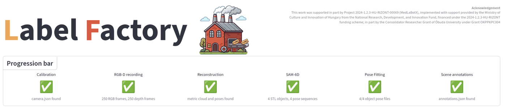
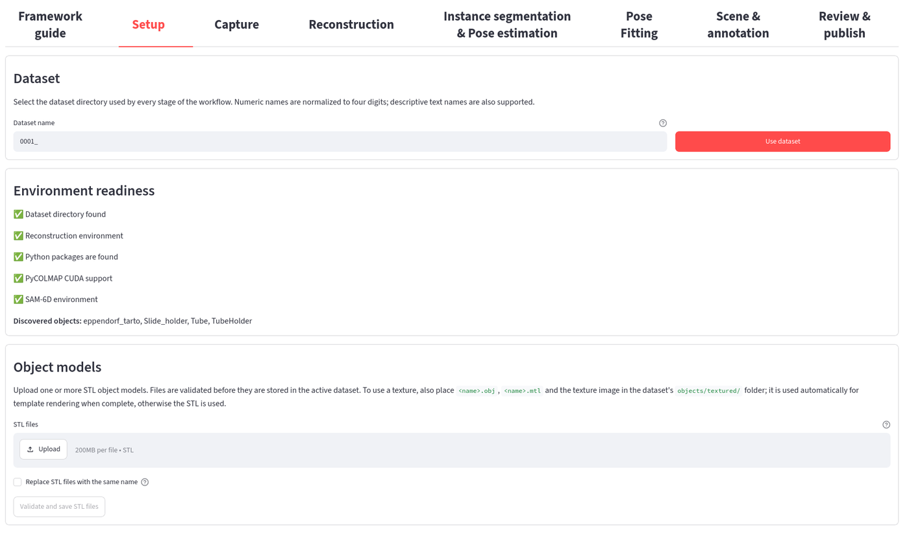
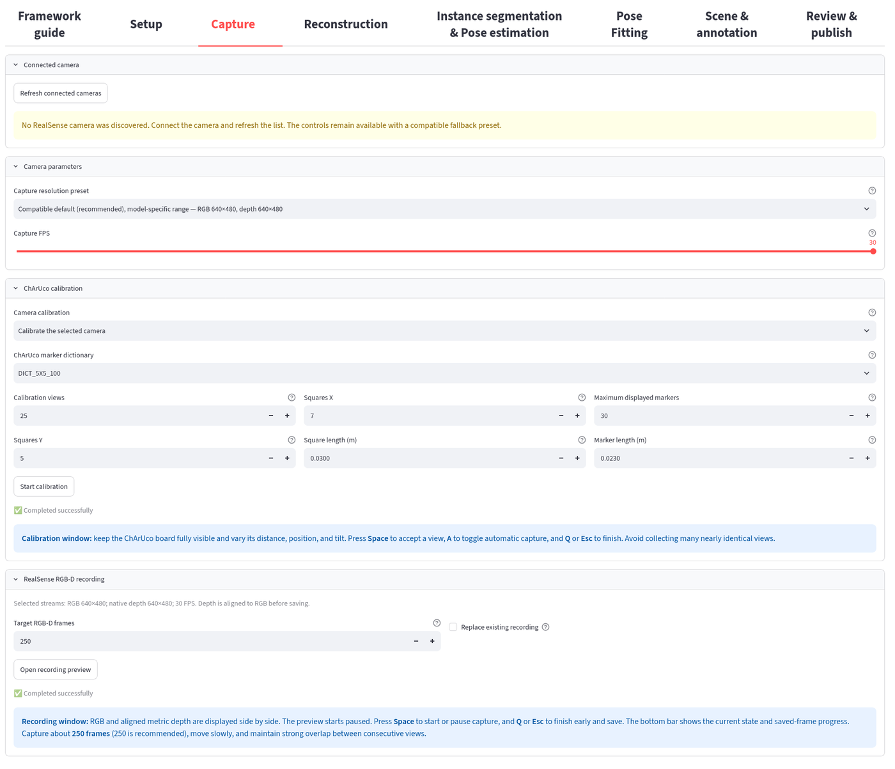
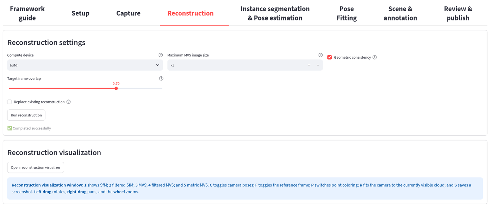
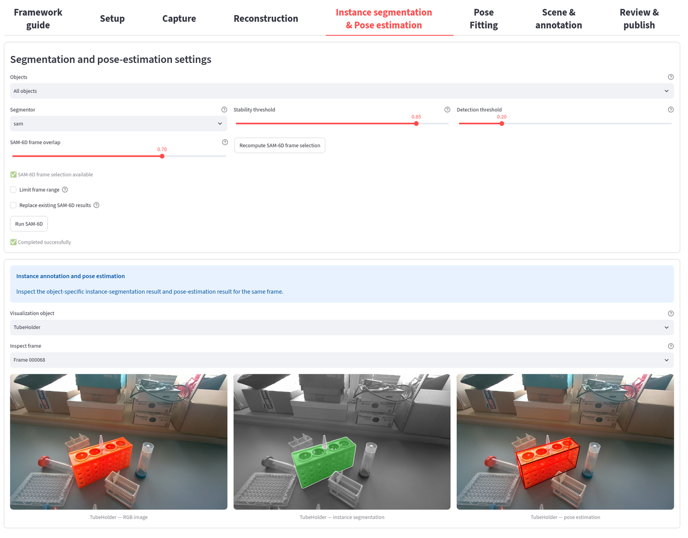
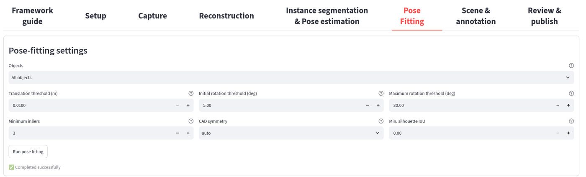
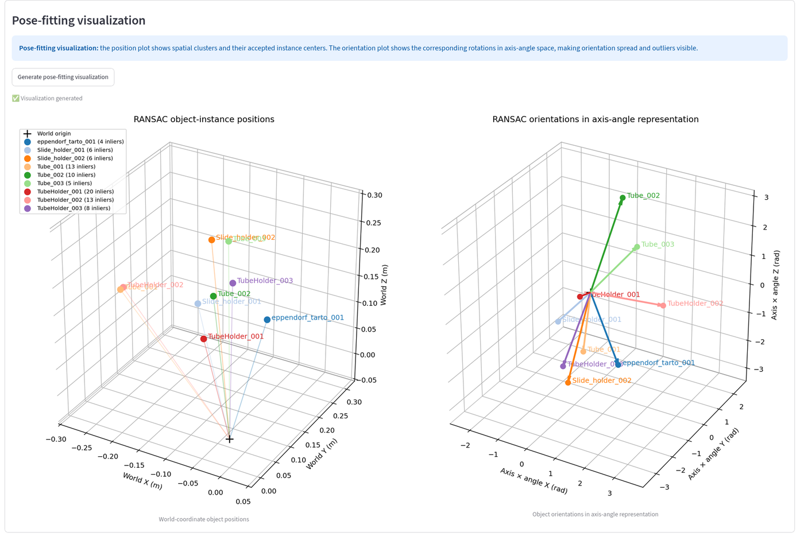
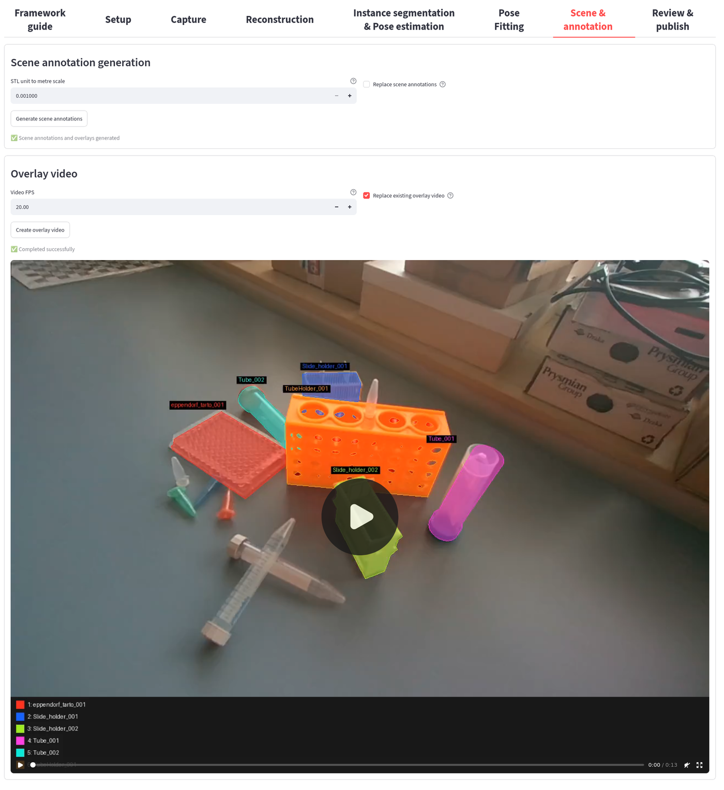
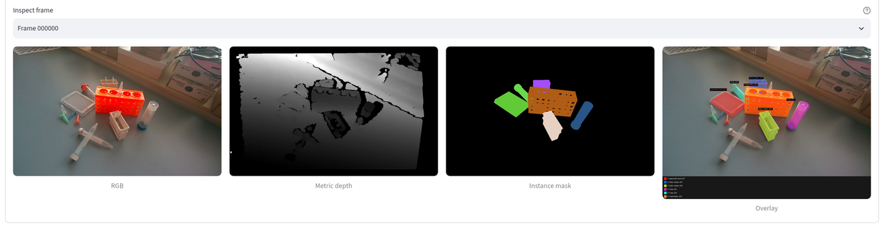
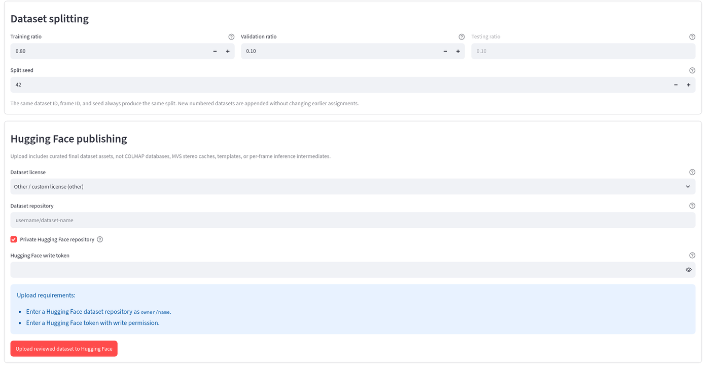

# User interface guide

This guide walks through the complete Label Factory workflow in the graphical
user interface, without typing any pipeline command. It follows the eight tabs
of the application from left to right, from an empty dataset to a reviewed
Hugging Face upload.

Every screenshot exists in a light and a dark variant; GitHub shows the one that
matches your colour theme automatically. The screenshots show a finished labware scene (dataset `0001_`, 250 RGB-D frames,
CAD models of a tube holder, a slide holder, two tube types and an Eppendorf
rack). The camera was not connected when the screenshots were taken, so the
camera list in the Capture tab is empty.

> The command-line equivalent of every step is described in
> [`USAGE.md`](USAGE.md). The UI always runs those same scripts and keeps the
> exact command and its log available at the bottom of the page.

## Contents

- [Starting the application](#starting-the-application)
- [How the interface is organised](#how-the-interface-is-organised)
- [1. Setup](#1-setup)
- [2. Capture](#2-capture)
- [3. Reconstruction](#3-reconstruction)
- [4. Instance segmentation and pose estimation](#4-instance-segmentation-and-pose-estimation)
- [5. Pose fitting](#5-pose-fitting)
- [6. Scene and annotation](#6-scene-and-annotation)
- [7. Review and publish](#7-review-and-publish)
- [Typical settings and run times](#typical-settings-and-run-times)
- [Common problems](#common-problems)

## Starting the application

With Docker (recommended, see [`DOCKER.md`](DOCKER.md)):

```bash
xhost +local:docker          # lets calibration/recording windows open on your desktop
docker compose --env-file docker/pipeline.rtx2000.env up label-factory
```

or in a native installation:

```bash
conda activate label-factory
streamlit run ui/app.py
```

Open <http://localhost:8501> in a browser. The camera calibration, the RGB-D
recording preview and the 3D reconstruction viewer open **native desktop
windows** next to the browser; everything else is shown in the browser itself.

## How the interface is organised

<picture>
  <source media="(prefers-color-scheme: dark)" srcset="images/ui_overview_dark.png">
  
</picture>

The **progression bar** at the top is the status of the active dataset. Each of
the six processing stages shows one of three symbols:

| Symbol | Meaning |
|---|---|
| ✅ | the expected output files of the stage exist |
| ▶️ | the inputs are available, the stage can be run |
| ⛔ | an earlier stage or an input is missing |

The tabs below it follow the workflow order. Some general rules apply to all of
them:

- A button is disabled until its inputs exist. The progression bar tells which
  stage is missing.
- Hover the **?** icon next to a control for a description of the setting.
- A long-running stage shows a spinner, then a notification (✅ success,
  ⚠️ warning, ❌ failure). The full log of the last process is at the very
  bottom of the page (**Last process log**).
- A stage that was already completed shows a green tick under its button. To
  recompute it, tick the **Replace existing …** checkbox first, otherwise the
  existing results are kept.
- The **Framework guide** tab contains a short explanation of every stage and
  what to check before continuing.

## 1. Setup

<picture>
  <source media="(prefers-color-scheme: dark)" srcset="images/ui_setup_dark.png">
  
</picture>

1. **Dataset.** Type a dataset name (for example `0008` or `workshop_scene`) and
   press **Use dataset**. Numeric names are normalised to four digits. Every
   later tab works on this dataset, which lives in `data/<name>/`. Changing the
   name only changes which folder is active, it never deletes anything.
2. **Environment readiness.** All five lines should be green: the dataset
   folder, the reconstruction environment, the required Python packages,
   PyCOLMAP with CUDA (needed for dense reconstruction) and the SAM-6D
   environment. A new dataset shows *“will be created by capture”*, which is
   normal. If a line is red, see [Common problems](#common-problems).
3. **Object models.** Upload one **STL** file for every object that has to be
   recognised and press **Validate and save STL files**.
   - The file name (without `.stl`) becomes the object name in all results, for
     example `Pliers.stl` → `Pliers`. Use letters, digits, dots, underscores
     and hyphens only.
   - The mesh is checked before it is stored: empty or unreadable geometry is
     rejected, and the triangle count, the size in the STL's own units and the
     watertight status are reported.
   - Existing models are protected; tick **Replace STL files with the same
     name** to overwrite them.
   - The mesh must have the real physical size. The scale unit (millimetres by
     default) is set in the Scene tab.
   - Optional texture: put `<name>.obj`, `<name>.mtl` and the texture image into
     `data/<name>/objects/textured/`. Complete textured models are used
     automatically for template rendering and are marked *(textured)* in the
     **Discovered objects** line.

**Continue when** the discovered-object list contains every object you expect.

## 2. Capture

Skip this tab if you already have an RGB-D sequence (see
[Using an existing sequence](#using-an-existing-sequence)).

<picture>
  <source media="(prefers-color-scheme: dark)" srcset="images/ui_capture_dark.png">
  
</picture>

### Camera and stream

- **Connected camera.** The connected Intel RealSense cameras are listed with
  their serial numbers. Press **Refresh connected cameras** after plugging a
  camera in. Without a camera the controls stay visible with a fallback preset.
- **Capture resolution preset.** The default is RGB 640×480 with depth 640×480.
  The higher-detail preset records 1280×720 RGB with 848×480 depth. Depth is
  always aligned to RGB and saved in millimetres.
- **Capture FPS.** 30 FPS is recommended; lower it only if the USB connection
  cannot keep up.

### Camera calibration

Calibration is part of the framework. It is done **once for each camera model
and RGB resolution** and then reused for every recording.

- **Camera calibration** drop-down:
  - *Calibrate the selected camera* creates a new calibration;
  - a name such as `RealSense D435I 2026-10-02` reuses a saved calibration. The
    UI warns if its resolution differs from the selected stream. **Use selected
    calibration** copies it into the active dataset as `camera.json`.
- For a new calibration, print a ChArUco board and enter its measured
  geometry: dictionary (`DICT_5X5_100` by default), squares in X and Y, the
  **measured** square and marker lengths in metres, and the number of views
  (25 by default).
- Press **Start calibration**. A native window opens:

  | Key | Action |
  |---|---|
  | **Space** | accept the current view |
  | **A** | toggle automatic capture |
  | **Q** / **Esc** | finish and save |

  Keep the whole board visible and vary its distance, position and tilt. Many
  nearly identical views add little. The result is stored in
  `calibration/cameras/<camera>_<date>/camera.json` and is available to every
  later dataset.

### RGB-D recording

1. Place the objects in their final positions. They must not move during the
   recording.
2. Set **Target RGB-D frames** (250 is recommended) and, if the dataset already
   holds a recording, tick **Replace existing recording**.
3. Press **Open recording preview**. A native window shows RGB and the aligned
   metric depth side by side. It starts **paused**.

   | Key | Action |
   |---|---|
   | **Space** | start / pause capturing |
   | **Q** / **Esc** | stop early and save |

4. Move the camera slowly around the scene so that neighbouring frames overlap
   strongly and every object is seen from several sides. Textured surroundings
   help camera tracking. Recording stops automatically at the target count.

**Continue when** the progression bar shows the RGB-D stage as ✅ with matching
RGB and depth counts, the images are sharp, and the important surfaces have
valid depth.

### Using an existing sequence

Instead of recording, you can copy an RGB-D sequence recorded elsewhere into the
dataset folder (`images/`, `depth_maps/`, `camera.json`; the layout is shown in
[`USAGE.md`](USAGE.md#expected-dataset-layout)). The progression bar then
shows ✅ and you can continue with Reconstruction.

## 3. Reconstruction

<picture>
  <source media="(prefers-color-scheme: dark)" srcset="images/ui_reconstruction_dark.png">
  
</picture>

This stage builds the metric 3D scene: structure from motion, sparse filtering,
dense multi-view stereo, outlier filtering, and the alignment to the sensor depth
that fixes the metric scale.

The defaults work for the 250-frame scenes of the paper; usually you only press
**Run reconstruction**. The settings are:

| Setting | Meaning |
|---|---|
| **Compute device** | `auto` uses CUDA when available. Dense reconstruction itself needs CUDA. |
| **Maximum MVS image size** | `-1` keeps the full resolution. Use a smaller value (for example 1000) on GPUs with little memory. |
| **Geometric consistency** | extra consistency pass between views: more reliable dense cloud, longer run time. |
| **Target frame overlap** | which frames are selected for dense reconstruction. Higher keeps more similar views, lower keeps fewer and more distinct ones. |
| **Replace existing reconstruction** | required to recompute a finished reconstruction. |

An error box appears if the selected Python has no CUDA-enabled PyCOLMAP.

### Checking the result

Press **Open reconstruction visualizer** to open an interactive 3D window:

| Key | Shows |
|---|---|
| **1** | SfM (sparse) |
| **2** | filtered SfM |
| **3** | MVS (dense) |
| **4** | filtered MVS |
| **5** | metric MVS |
| **C** | toggle camera poses |
| **F** | toggle the reference frame |
| **P** | switch point colouring |
| **R** | fit the view to the visible cloud |
| **S** | save a screenshot |

Mouse: left-drag rotates, right-drag pans, the wheel zooms.

**Continue when** the camera path is smooth, the surfaces are coherent, the
object dimensions look plausible and nothing is doubled. Floating regions, a
broken trajectory or duplicated surfaces mean the capture should be repeated
with more overlap or more texture.

## 4. Instance segmentation and pose estimation

<picture>
  <source media="(prefers-color-scheme: dark)" srcset="images/ui_sam6d_dark.png">
  
</picture>

This stage runs SAM-6D for the uploaded CAD models. Segment Anything proposes
object masks once per frame, the rendered CAD templates match them to the known
objects, and the pose network estimates a 6D pose for every matched mask.

| Setting | Meaning |
|---|---|
| **Objects** | all uploaded models (default) or one selected model. |
| **Segmentor** | `sam` (best masks, default) or `fastsam` (faster, lighter). |
| **Stability threshold** | minimum SAM mask-stability score (0.85). Higher keeps fewer, more stable proposals. |
| **Detection threshold** | minimum object-matching score (0.20). Lower keeps more candidates, with more false detections. |
| **SAM-6D frame overlap** / **Recompute SAM-6D frame selection** | picks the image subset used for inference without touching the reconstruction. |
| **Limit frame range** | processes only a start–end interval of frame IDs, useful for a quick test. |
| **Replace existing SAM-6D results** | recompute instead of reusing finished results. |

Press **Run SAM-6D**. This is the longest stage (about 59 % of the total run
time of a scene).

### Checking the result

Below the settings, choose a **Visualization object** and a **frame**. Three
images are shown for the same frame: the RGB image, the instance segmentation
(the matched mask in green) and the estimated pose (the CAD outline projected
into the image).

**Continue when** the masks cover whole objects, separate instances stay
separate, and the pose outlines sit on the objects in most frames. Single wrong
frames are expected; the next stage removes them. Consistently missing masks, or
no depth inside the masks, must be fixed first (check the model scale and
lighting, or lower the detection threshold).

## 5. Pose fitting

<picture>
  <source media="(prefers-color-scheme: dark)" srcset="images/ui_pose_settings_dark.png">
  
</picture>

The per-frame poses are transformed into the metric scene and combined into
one robust pose per object instance: positions are clustered first, so the
number of instances does not have to be known, then a RANSAC fit of the
orientation is run in each cluster. Symmetric objects are handled
automatically from the CAD model.

| Setting | Default | Meaning |
|---|---|---|
| **Translation threshold (m)** | 0.01 | maximum distance of observations that belong to the same instance. Too small splits one object, too large merges neighbouring copies. Use about 0.005 for small hand tools. |
| **Initial rotation threshold (deg)** | 5 | starting angular tolerance for the orientation fit. |
| **Maximum rotation threshold (deg)** | 30 | the tolerance may be relaxed up to this value if needed. |
| **Minimum inliers** | 3 | number of different frames that must support a pose. |
| **CAD symmetry** | auto | `auto` detects rotational equivalences from the mesh; `none` treats all orientations as different. |
| **Min. silhouette IoU** | 0 | optional verification: reject a pose if the CAD silhouette overlaps the observed masks with a lower median IoU. 0 keeps all clusters (the IoU is still stored). |

Press **Run pose fitting**. The **Fitted objects** panel then lists how many
instances were found for each object, and which objects were not found.

### Checking the result

<picture>
  <source media="(prefers-color-scheme: dark)" srcset="images/ui_pose_plots_dark.png">
  
</picture>

Press **Generate pose-fitting visualization**. The left plot shows the accepted
instance centres in world coordinates, with the number of supporting frames
(inliers) in the legend. The right plot shows the corresponding orientations in
axis-angle form.

**Continue when** the instance positions agree with the physical scene and the
instance counts are plausible. Objects with few inliers are less reliable and
may deserve a re-run with different thresholds; objects that were *not found*
are simply left out of the annotation.

## 6. Scene and annotation

<picture>
  <source media="(prefers-color-scheme: dark)" srcset="images/ui_scene_dark.png">
  
</picture>

The fitted poses place the CAD models in the metric reconstruction. For every
RGB frame the known camera pose and the calibrated intrinsics project the
meshes into the image; depth-aware rendering handles occlusion and gives each
instance a stable identity and colour over the whole sequence.

1. Set **STL unit to metre scale**: `0.001` if the CAD files are in millimetres
   (the usual case), `1.0` for metres.
2. Press **Generate scene annotations**. This creates the instance masks, the
   per-frame annotation files, the overlays and `annotations.json`.
3. Set the **Video FPS** (20 by default) and press **Create overlay video**.
   The review video is played directly in the page.

**Continue when** the coloured silhouettes stay attached to the right physical
objects during the whole video, keep their identity between views and respect
occlusion. A systematic shift points to a wrong pose, model scale or camera
calibration and must not be published.

## 7. Review and publish

The last tab collects the evidence in one place, packages the dataset and
uploads it to Hugging Face. Approval is always made by a person.

### Review

<picture>
  <source media="(prefers-color-scheme: dark)" srcset="images/ui_review_frame_dark.png">
  
</picture>

The tab shows the list of the included content, the pose-fitting plots, the
overlay video and a **single-frame inspector**: choose a frame to compare its
RGB image, the metric depth, the instance mask and the overlay side by side.

- **Cleanup the unnecessary files** permanently deletes reproducible
  intermediates (reconstruction work files, SAM/DINO caches, rendered
  templates, per-frame diagnostics) and keeps the RGB-D input, STL models,
  metric reconstruction, camera poses, fitted poses, annotations, masks,
  overlays and publication files. Run it only after pose fitting and scene
  annotation are finished and checked.
- **Refresh dataset content inventory** (also executed automatically when the
  tab is opened) validates the outputs and shows the number of RGB-D frames,
  objects, files and the upload size. Missing required files are listed as
  errors, and **Files selected for upload** shows the exact list. The inventory
  report can be downloaded as JSON.

### Splitting and upload

<picture>
  <source media="(prefers-color-scheme: dark)" srcset="images/ui_publish_dark.png">
  
</picture>

- **Dataset splitting:** training and validation ratios (0.80 / 0.10) and the
  seed (42); the test ratio is the remainder. The assignment is deterministic
  (dataset ID + frame ID + seed), so adding captures later never moves existing
  frames between splits.
- **Hugging Face publishing:**
  1. choose a **license** that is compatible with the images, annotations and
     models you publish (this is not legal advice);
  2. enter the target repository as `owner/name`, for example
     `KarolyArmin/Hand_tools`;
  3. keep **Private Hugging Face repository** ticked when the repository does
     not exist yet and you want it created as private;
  4. paste a Hugging Face **write token** (create it at
     <https://huggingface.co/settings/tokens>). It is passed to the upload
     process as an environment variable and is not written to disk or to the
     command line.
  5. The blue **Upload requirements** box lists what is still missing. When it
     disappears, press **Upload reviewed dataset to Hugging Face**.

The upload always creates a **pull request** on the Hugging Face repository
instead of committing directly, so you can inspect the files and the generated
dataset card there and merge them yourself. The result contains the
`depth_estimation`, `instance_segmentation`, `object_pose_estimation` and
`object_pose_models` configurations. The dataset card has ready-to-run loading
examples.

## Typical settings and run times

| Scene type | Frames | Translation threshold | Rotation threshold | Run time |
|---|---|---|---|---|
| Hand tools | 250 | 5 mm | 5° → 30° | ≈ 27 min |
| Labware | 250 | 10 mm | 5° → 30° | ≈ 33 min |

The times are the measured averages on an RTX 2000 Ada Laptop GPU (8 GB) from
the paper; the SAM-6D stage takes about 59 % of them.

## Common problems

| Symptom | What to do |
|---|---|
| Red line in **Environment readiness** | The selected Python environment lacks a package or CUDA. In Docker rebuild the image; natively follow the installation chapter of the [README](../README.md#installation). |
| A button is greyed out | The previous stage is not finished. Look at the ⛔ stage in the progression bar. |
| No camera in the list | Reconnect the camera (USB 3), press **Refresh connected cameras**. In Docker see the camera access section of [`DOCKER.md`](DOCKER.md). |
| Calibration/recording window does not open in Docker | Run `xhost +local:docker` on the host before starting the container. |
| *“This calibration is for … but the selected RGB stream is …”* | Select the resolution preset that matches the saved calibration, or calibrate again. |
| Out of CUDA memory during reconstruction or SAM-6D | Lower **Maximum MVS image size**, use the `docker/pipeline.rtx2000.env` profile, process fewer frames with **Limit frame range**, or use `fastsam`. |
| An object is *not found* in pose fitting | Check its masks in tab 4, lower the detection threshold, or increase the translation threshold slightly and re-run pose fitting. |
| Overlay is shifted | Check the model scale (tab 6), the STL real-world size and the calibration. |
| Upload requirements never disappear | Enter `owner/name`, a token with write permission, and refresh the inventory. |

More background and the command-line options are in [`USAGE.md`](USAGE.md).
